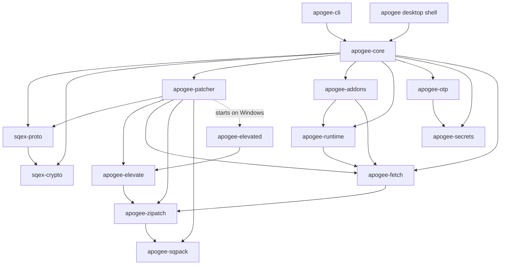

<p align="center">
  <picture>
    <source media="(prefers-color-scheme: dark)" srcset=".github/assets/apogee-wordmark-dark.svg">
    <source media="(prefers-color-scheme: light)" srcset=".github/assets/apogee-wordmark-light.svg">
    
  </picture>
</p>

[](https://github.com/soleynn/apogee/actions/workflows/ci.yml)
[](https://github.com/soleynn/apogee/actions/workflows/codeql.yml)
[](https://github.com/soleynn/apogee/releases/latest)
[](https://github.com/soleynn/apogee/releases)
[](LICENSE)
[](rust-toolchain.toml)
[](#install)

A from-scratch, Linux-first launcher for FINAL FANTASY XIV. Apogee reimplements the Square Enix
login protocol, ZiPatch patching and repair, and Wine/Proton runner management as a workspace of
standalone Rust crates. A headless CLI drives all of it today; a Tauri 2 desktop app is being built
on the same core.

## Status

| Surface | Path | State |
| --- | --- | --- |
| CLI | `apps/apogee-cli` | Usable. Logs in, patches, installs, repairs, and launches the game. Stable releases ship it as a Linux binary. |
| Desktop app | `apps/apogee` | In progress. The window drives the full core command surface, but the frontend so far renders only startup recovery, a renderer legibility check, and the quit-during-work confirmation. Not packaged or released. See [its README](apps/apogee/README.md). |
| Elevated patch worker | `apps/apogee-elevated`, `crates/apogee-elevate` | For Windows. When the install tree is not writable by the user, the patcher starts this worker with raised privileges and hands it patch files it has already downloaded; the worker re-verifies each one and writes only inside the bound install tree. It has no network access. On Linux it is never needed. |

The latest stable release is v0.4.0; v0.5.0-pre.1 is a pre-release checkpoint without binaries.
`main` is ahead of both, and commands marked *(unreleased)* below are on `main` only.

## Features

**Login and one-time passwords**
- Square Enix OAuth login, session registration, and launch for the global service (`login`,
  `launch`, `play`). A session that is still valid is reused rather than logging in again.
- Passwords kept in the OS credential store, a passphrase-sealed file, or nowhere (prompt each
  time); import a password XIVLauncher saved (`secrets`).
- One-time passwords typed in, generated from a stored TOTP secret (`secrets totp`), or received
  from a phone companion app over a local listener on port 4646 (`otp`).
- World-gate status, waiting for maintenance to end, news headlines, and banners (`gate`, `news`,
  `banners`) *(unreleased)*.

**Patch, install, and repair**
- Apply pending boot and game patches in the order Square Enix requires, resuming an interrupted
  download (`patch`), or install the game from an empty directory (`install`).
- Every patch is verified before a byte of it is applied: per-block SHA1 for game patches, a
  ZiPatch CRC scan for boot patches.
- Repair verifies the install against signed block indexes and re-fetches only the byte ranges
  that are broken, from kept patch files when available; files it cannot explain are moved aside,
  never deleted (`repair`).

**Runners**
- Host Wine, or managed GE-Proton and wine-xiv builds from an Ed25519-signed catalog, with
  umu-launcher for Proton (`runner list` *(unreleased)*, `profile add --runner`).
- DXVK and its nvapi companion installed from the same catalog (`dxvk list` *(unreleased)*).
- Per-profile tuning: sync mode (ntsync, fsync, esync), MangoHud or DXVK HUD, GPU selection,
  gamescope, GameMode, extra arguments, environment, and wrappers (`profile env`, `profile edit`
  *(unreleased)*).
- Create, health-check, fix in place, or recreate a profile's Wine prefix (`prefix`).

**Add-ons**
- Dalamud, opt-in per profile and best effort: a game patch usually leaves it behind for a day or
  two, and the game starts without it until it catches up (`dalamud`).
- Your own tools (ACT, overlays, scripts) run alongside the game, either natively or inside the
  prefix, stopped with it or kept running (`addon`).
- Back up, restore, and prune the game's settings, optionally before every patch (`backup`).

**Steam and Steam Deck**
- Detects a Steam Deck from its firmware, and SteamOS and the Steam session separately
  (`steam status`).
- Registers a profile as a Steam compatibility tool, so it starts from the Steam interface on a
  handheld with no desktop (`steam register`, `steam unregister`).
- Steam-licensed accounts are modelled, but logging in with one is not possible yet: this build
  cannot obtain a Steam authentication ticket.

**XIVLauncher import** *(unreleased)*
- Scan an XIVLauncher data directory and import its accounts and game paths, with a dry run and
  per-candidate selection (`import xivlauncher`). No credentials are read by the scan.

**Diagnostics**
- Frame-consistency metrics from MangoHud frametime logs (`bench analyze`).
- A public system report and a redacted support archive built from an explicit allowlist
  (`system-report`, `support-bundle`) *(unreleased)*.
- Diagnostic logging to stderr with `--log` or `APOGEE_LOG`, and `--events-json` for a stable,
  error-redacted event stream *(unreleased)*.

## Install

Stable releases ship the CLI for **x86_64 Linux**, which includes the Steam Deck. Each release has
a tarball and its SHA256 checksum:

```sh
v=v0.4.0
pkg=apogee-cli-$v-x86_64-unknown-linux-gnu
curl -LO https://github.com/soleynn/apogee/releases/download/$v/$pkg.tar.gz
curl -LO https://github.com/soleynn/apogee/releases/download/$v/$pkg.tar.gz.sha256
sha256sum -c $pkg.tar.gz.sha256
tar -xzf $pkg.tar.gz
install -Dm755 $pkg/apogee-cli ~/.local/bin/apogee-cli
```

The tarball holds one directory, `apogee-cli-<version>-x86_64-unknown-linux-gnu/`, with the
stripped `apogee-cli` binary and the `LICENSE`. Pre-releases carry no binaries. CI cross-compiles
the workspace for Windows, but no stable release has shipped a Windows build yet.

## Quick start

```sh
# A profile for an existing install: the directory that holds boot/ and game/.
# Add --otp if the account uses one-time passwords, --runner managed:<name>@<version>
# to use a managed runner instead of the host's Wine.
apogee-cli profile add --name main --user your-square-enix-id --game-path ~/Games/FFXIV
apogee-cli profile list

apogee-cli play --profile main      # log in, apply pending patches, launch (asks for the password)
apogee-cli install --profile main   # or: install into an empty --game-path, then launch
apogee-cli repair --profile main    # verify against the signed block indexes, fix what is broken
apogee-cli steam status             # what this machine is, and whether Steam knows about a profile
```

`apogee-cli --help` and `apogee-cli <command> --help` list everything else. The default runner is
`system`, the host's own Wine.

## Building from source

The toolchain is pinned to Rust 1.97.0 in `rust-toolchain.toml`, which rustup picks up on its own.

```sh
cargo build --release -p apogee-cli   # target/release/apogee-cli
cargo test --workspace
```

The root workspace is `crates/*`, `apps/apogee-cli`, and `apps/apogee-elevated`. The desktop shell
(`apps/apogee/src-tauri`), each tool under `tools/`, and `fuzz/` are separate Cargo workspaces, so
the root build never needs WebKitGTK, a live account, or a nightly compiler. The desktop app also
needs Node and the webview development packages; see [apps/apogee/README.md](apps/apogee/README.md).

## How it fits together

All logic lives in the crates. `apogee-core` is the only crate that sees every subsystem: it wires
them together and exposes one command surface that yields a stream of events, and the CLI and the
desktop shell are thin front ends over it.

| Crate | What it does |
| --- | --- |
| `apogee-core` | The launcher core: domain model, versioned persistence, and the command/event surface the shells drive. |
| `sqex-proto` | Square Enix's launcher network protocol: OAuth login, version and boot checks, patchlist parsing. |
| `sqex-crypto` | Square Enix's launcher cryptography. |
| `apogee-patcher` | Patch orchestration across download, apply, and repair. |
| `apogee-zipatch` | ZiPatch parsing, and the seams for applying, indexing, and repairing an install. |
| `apogee-sqpack` | SqPack container formats and the compressed-block codec. |
| `apogee-fetch` | Resumable, verified HTTP downloads. |
| `apogee-runtime` | Wine and Proton runner management, prefix lifecycle, and process supervision. |
| `apogee-addons` | What runs alongside the game, and the prefix setup it needs. |
| `apogee-secrets` | OS keyring-backed storage for account secrets. |
| `apogee-otp` | Time-based one-time-password codes, and the local listener a companion delivers one to. |
| `apogee-elevate` | The privilege boundary a patch apply crosses when the install tree is not writable. |
| `apogee-test-support` | Test-only harness: byte-diff goldens, redaction, sandboxes, a fixture transport. |



`apogee-test-support` is left out: it is a dev-dependency of most crates and never ships.

## Security and trust

- Account passwords and one-time-password secrets live in the OS credential store (Secret Service
  on Linux) or, if you opt in, a passphrase-sealed file. They are held in zeroizing buffers and are
  never taken as command-line arguments.
- The client that carries credentials trusts only the roots Square Enix's login endpoints issue
  from, not every root on the machine.
- Runner, component, and block-index catalogs are Ed25519-signed and verified against a key
  compiled into the launcher before any of their content-hash pins is trusted.
- Patches are verified before they are applied, and everything Square Enix's servers send is
  parsed as untrusted input.

To report a vulnerability, see [SECURITY.md](SECURITY.md).

## Contributing

Bug reports and ideas are welcome as issues. Code contributions are by invitation; see
[CONTRIBUTING.md](CONTRIBUTING.md).

## License

GNU General Public License v3.0 or later (GPL-3.0-or-later). See [LICENSE](LICENSE).

Apogee is an independent project. It is not affiliated with or endorsed by Square Enix. FINAL
FANTASY XIV is a trademark of Square Enix.
